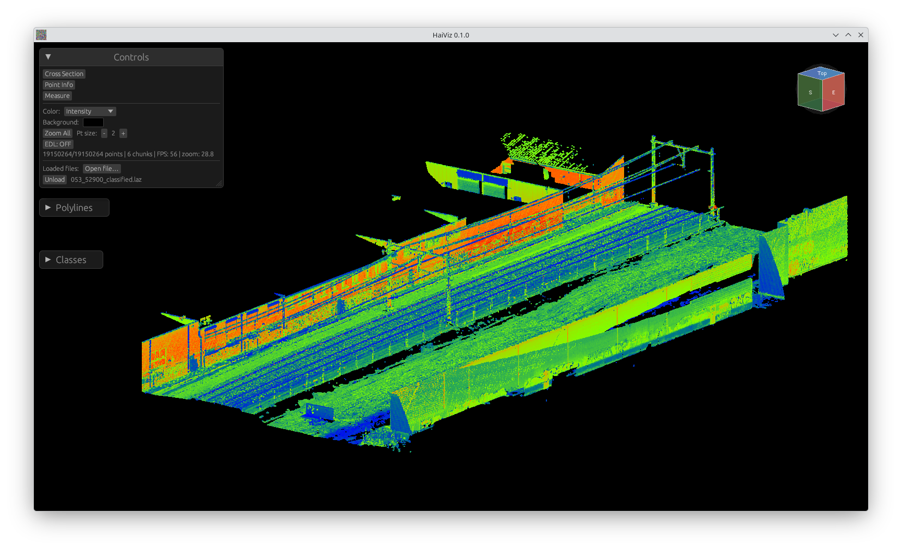

# HaiViz

A point-cloud viewer for LAS / LAZ data, built with
[macroquad](https://github.com/not-fl3/macroquad) and
[egui](https://github.com/emilk/egui). It renders large clouds with an
orthographic camera, extracts vertical cross sections, overlays polylines, lets
you reclassify points by hand, and exports the result with chosen classes
filtered out.



<!-- Placeholder — drop a real screenshot at docs/screenshot.png to replace this. -->

## Building

Assuming that the Rust toolchain is installed:

```sh
cargo build --release
```

Or just download the latest binaries from the [Releases](https://github.com/tfwittwer/HaiViz/releases) page.

## Usage

```sh
cargo run --release -- [PATH]
```

or, if the binary is on your PATH

```sh
haiviz [PATH]
```

`PATH` is optional and decides which mode haiviz starts in (see below). Release
mode is strongly recommended — point loading and colouring are much faster.

## Loading modes

The kind of `PATH` you pass selects one of three modes automatically:

### 1. Single file / manual loading

```sh
cargo run --release -- cloud.laz
```

Pass a single `.las` / `.laz` file and the whole cloud is loaded into memory at
once. You can keep loading more individual files after launch:

- **Open file…** button in the control panel, or
- **drag & drop** one or more `.laz` / `.las` files onto the window
  (Windows / X11; on Wayland use the *Open file…* button).

Each file becomes its own entry in the **Loaded files** list, where you can
**Unload** it again. This is the mode to use for browsing a handful of tiles or
comparing several clouds side by side.

Launching with no `PATH` starts in this mode with an empty window, ready for
drag & drop or *Open file…*.

### 2. Tiles

```sh
cargo run --release -- /path/to/tile_directory/
```

Pass a **directory** and haiviz enters tile mode: it indexes every LAS/LAZ tile
in the folder and shows their footprints. Tiles are streamed on demand rather
than all held in memory —

- **click** a tile footprint to select it,
- **Enter** loads the selected tile, **Delete** unloads it,
- **Zoom on Object** frames the current selection.

If the directory also contains COPC files, they are loaded alongside the tiles
under a shared coordinate origin.

### 3. COPC

```sh
cargo run --release -- cloud.copc.laz
```

If the file you pass is a [COPC](https://copc.io/) (Cloud Optimized Point Cloud)
LAZ — detected from its COPC info VLR — haiviz streams it from its octree
hierarchy, loading finer detail near the camera and releasing distant nodes.
This is the mode for very large clouds that don't fit in memory. Multiple COPC
files can be loaded together, each listed under **Loaded COPC files** with its
own **Unload** control.

You can create COPC files out of conventional LAZ files with [copc-converter](https://github.com/360-geo/copc-converter).

## The panel

Everything lives in one panel docked to the left of the window, with
collapsible sections:

- **Controls** — camera, colouring, height filter, cross sections, measure;
- **Classes** — labels, colours and visibility per class, and the class
  definition files;
- **Classification** — the lasso tools, **Undo last op** and **Export**, which
  are one job;
- **Digitising** — snap mode, radius and the line being drawn, and editing the
  lines already there;
- **Polylines** and **Ground Control Points** — the overlays.

Drag the panel's inner edge to resize it. It is docked left so that the view
cube in the top-right corner stays clear. With the pointer over the panel, the
mouse wheel scrolls the panel rather than zooming the view.

The 3D and section views render **beside** the panel rather than underneath it,
so nothing is hidden behind it and **Zoom All** frames into the space you can
actually see.

## Navigation

The 3D view uses an orthographic camera shared across all modes:

| Input | Action |
|-------|--------|
| `W` `A` `S` `D` / arrow keys | Move the camera |
| Left-drag | Orbit around the screen centre |
| Right-drag | Pan |
| Mouse wheel | Zoom (orthographic scale); over the panel, scroll the panel |
| `Tab` | Toggle mouse-look (cursor grab) |
| `C` | Start a cross section (press again to cancel) |
| `G` / `V` | Start the above-ground / inside lasso (press again to cancel) |
| `P` | Start digitising a polyline (press again to cancel) |
| `T` `F` `B` `L` `R` | Snap to top / front / back / left / right view |
| `Esc` | Cancel the current pick / measure / section action |
| **Zoom All** button | Frame all loaded data |

View shortcuts follow the usual CAD convention, where a view is named for where
the camera sits rather than the direction it looks: `F` looks north from the
south, `R` looks west from the east. They match the faces of the view cube in
the top-right corner. Shortcuts are suppressed while a text field has focus, so
typing a class label does not move the camera.

## Colouring

The **Color** dropdown switches how points are shaded:
Height, Intensity, Classification, RGB, PointSourceId, or Time. In **Height**
mode you can set the min/max range used for the colour ramp, in absolute
elevation. The **Background** colour and **point size** are adjustable, and an
EDL (eye-dome-lighting) **Strength** slider adds depth shading.

The section view keeps its own colour mode. Switching to Classification to
check your work on a slice does not repaint the 3D view, and the 3D dropdown
goes on reporting the mode the 3D view is actually drawn in. Once you pick a
mode there it sticks: the next cross section opens in it too, so a cut →
classify → back → cut again loop does not mean reselecting it every time.
Until you first choose one, a section opens in whatever the 3D view is using.

## Height filter

Multi-level clouds — a building over a basement, a deck over the ground below —
are hard to work on when everything is drawn at once. Tick **Height filter** and
set **Top** and **Bot** to restrict the view to one band. Values are absolute
elevations, the same numbers Point Info reports.

The band applies everywhere, not just to the display:

- points outside it are not drawn,
- they are excluded from cross sections,
- they cannot be picked by **Measure**, **Point Info**, or the classification
  lasso, so you cannot accidentally act on geometry you cannot see,
- the height colour ramp re-ranges to the band, so the whole gradient is spent
  on the part you are looking at instead of on levels that are hidden.

**Full range** resets it to the whole dataset. The filter is a view setting — it
does not affect what an export writes. Use the **Omit classes** list for that.

## Class visibility

Each row of the **Classes** section has a checkbox. Clear it and that class is
switched off; **only** beside a row isolates it, and **All** / **None** /
**Invert** act on every listed class at once.

Like the height filter, this is not only a display setting. A hidden class:

- is not drawn,
- is excluded from cross sections,
- cannot be picked by **Measure** or **Point Info**,
- is ignored by the classification lassos,
- is left out of the ground-plane fit.

That last one is a real gain rather than a restriction: hide everything except
class 2 and the **Above ground** lasso fits its plane to actual ground instead
of to whatever minima it found under the vegetation.

Two things worth knowing:

- **Visibility does not affect export.** Same as the height filter — use
  **Omit classes** for that. Hiding a class and exporting still writes it.
- **A hidden class is invisible in more ways than one.** While any class is
  hidden the classification controls say so, because a lasso that catches nothing
  is otherwise very confusing.

If you set **Only from: 5** while class 5 is hidden, the two exclude each other
and the lasso is refused with an explanation rather than silently doing nothing.

Visibility is a view setting and is **not** written to `classes.txt` — that file
keeps its documented `id;r;g;b;label` format.

## Cross sections

Cross sections cut a vertical slice through the cloud along a line you draw:

1. Click **Cross Section** in the control panel.
2. Click the **start** point, then the **end** point of the section line.
3. **Scroll** to adjust the section **depth** (the corridor half-width around the
   line), then click to confirm.

You then drop into the 2D **section view**, looking straight at the slice.
There you can:

- **scroll** to zoom the section,
- **Measure** distances between two clicked points (with slope readout),
- click **Point Info** and then a point to inspect its attributes; the
  **Copy** buttons beside the coordinate and GPS time readouts put those
  values on the clipboard (coordinates tab separated),
- see any polylines that cross the corridor drawn into the slice,
- **digitise** polylines in the slice with `P` — see
  [Digitising in a section](#digitising-in-a-section).

Click **Back to 3D** to return.

## Polylines

Open the **Polylines** section and **Load Polyline File…** to overlay vector
lines on the cloud. Two formats are read and written:

- **GeoPackage** (`.gpkg`) — the OGC container QGIS and GDAL use. Every line
  and polygon feature table in the file becomes a layer. 3D geometry
  (`LineStringZ`, `MultiLineStringZ`, `PolygonZ`) keeps its elevations; a 2D
  layer loads with `z = 0`, which is what the file actually said.
- **Salome Hydro polyline ASCII** — one `x y z` per line, with blank lines
  separating individual polylines. No attributes, no layers, no CRS.

The format is detected from the file's **contents**, not its extension, so a
GeoPackage named `.db` and a Salome file named `.txt` both load correctly.
Coordinates are interpreted in the same CRS as the cloud (the viewer subtracts
the data origin automatically) and are held in full double precision, so an
external GeoPackage round-trips without its coordinates being quantised.

Each loaded file is listed as a tree — file, then layer, then line — where you
can:

- toggle a **layer**'s visibility, set its **EPSG** code and its drawn
  **width** in pixels,
- select a polyline,
- change its **colour**,
- adjust its **radius** (line thickness, in metres — this sets how wide it draws
  in the section view),
- **Save** (writes back in the format it came from) or **Save As…** (the
  extension you choose decides the format), and
- **Remove file** to unload it.

Polylines are drawn both in the 3D view and, where they intersect the corridor,
in cross-section view.

### Saving

Saves are atomic: the new file is written beside the target and renamed over it,
so a crash mid-write cannot destroy the version that was already there. If the
file changed on disk since it was loaded — someone editing the same GeoPackage
in QGIS — the save stops and says so rather than overwriting their work.

Salome ASCII carries no attributes, no layers and no CRS, so saving a
GeoPackage as one loses things. haiviz lists exactly what would go and waits for
you to confirm.

Attribute columns are preserved. A GeoPackage from QGIS is written back with the
columns it arrived with, values and all — only `name`, `n_vertices` and
`length_3d` are refreshed, because after an edit the stored ones are simply
wrong. A layer haiviz creates gets `fid, geom, name, code, n_vertices,
length_3d, created`.

**A `-wal` sidecar is refused.** A write-ahead log means committed rows live
outside the main file, so reading it alone would quietly give you the state
before whatever the other program last wrote. Close the file there, or run
`sqlite3 <file> "PRAGMA wal_checkpoint(TRUNCATE);"` first.

## Vectorisation

Press `P` or use **Digitise** in the Digitising panel to draw polylines
straight onto the cloud. Click to place a vertex and it is *snapped* onto real
data — the elevation is measured, not invented. Shift-click places one freely
instead, at the previous vertex's height, which is what lets you draw across a
gap in the data.

`Backspace` removes the last vertex, `Enter` finishes the line, `Esc` discards
it and a second `Esc` leaves digitising. `Shift+Enter` finishes it as a closed
ring instead, for outlines. Between lines, `Ctrl+Z` takes back the last
committed change — starting with the line you just finished.

A readout follows the cursor with the distance and height difference to the
previous vertex, its slope, and the running total — so the numbers are where
you are looking rather than off in the panel. When a snap is refused, the reason
appears there too. The panel carries the same figures for the line as drawn so
far.

Lines are drawn as real 3D geometry, so they are hidden by the points in front
of them. That is what lets you tell where a line actually sits rather than
merely where it projects to. That holds with **EDL: ON** too: eye-dome lighting
shades the cloud in an offscreen buffer, and the cloud's depth is replayed into
the view afterwards so the lines can still be hidden by it — at the cost of
drawing the points twice while EDL is on.

### Snapping

`N` cycles the snap mode; **Ctrl + mouse wheel** changes the radius (the plain
wheel keeps zooming). The radius is an absolute distance in metres, default
**0.2 m** — absolute rather than zoom-relative because a metre means the same
thing at every zoom level, which is what makes a snap reproducible.

| Mode | What it takes | Good for |
|------|---------------|----------|
| **Nearest point** | The real point under the cursor — the first surface along its line of sight, reaching out to the radius only over gaps | General tracing; works from any camera angle |
| **Low Z** | A low percentile of Z within the radius | Gutters, ditch invert, toe of slope |
| **High Z** | A high percentile of Z within the radius | Kerb top, crest, cable, roof ridge |
| **Same Z as previous** | The cursor's XY at the previous vertex's height | Contours, breaklines |
| **Existing polyline** | The nearest vertex or segment of a drawn line | Closing loops, tying into neighbours |

Percentiles rather than the raw minimum and maximum, because a raw extreme on
LiDAR is usually one stray return — a single low point puts a ditch invert 30 cm
under the ground. The default is the **5th** and **95th** percentile, both
adjustable; setting one to 0 or 100 gives the raw behaviour back.

**Class visibility is what makes this precise.** Every snap query honours the
height band and the hidden classes, so hiding everything but ground makes "low
Z in radius" mean the ground, and showing only class 6 makes it mean the
building. See [Class visibility](#class-visibility).

The marker under the cursor is a cross with a circle at the snap radius, drawn
at the **snapped** height, so you can see what the percentile is being taken
over. It turns orange and the click is refused when the snap cannot be trusted:

- **nothing within the radius** — widen it, or Shift-click;
- **the point spacing is wider than the radius** (COPC, zoomed out) — the
  resident data is a thinned sample of the file, so a percentile over it would
  be wrong by decimetres with nothing looking wrong. Zoom in, or widen the
  radius.

A snap never silently falls back to something you did not ask for. While
digitising on a COPC file, haiviz also force-loads the octree nodes in a 20 m
box around the cursor, so there is full-resolution data to snap to; if that box
would pull in more than 5 million points it is skipped and the panel says so.

### Edge following

Press `E` while digitising, or tick **Edge following** in the panel, and the
segment from the last vertex to the cursor stops being straight: it follows the
strongest edge in the data — a kerb, a breakline, a painted line, a wall foot. A
click commits the traced route, simplified to a handful of vertices, and ends
wherever the snap mode puts it, exactly as without tracing. Every traced vertex
is snapped at full resolution as it is placed; if any of them has nothing within
the radius the click is refused and says why, rather than committing a route
with invented heights. `Backspace` takes back the whole traced click.

**How it works.** When you place a vertex, haiviz looks at the points in a
square around it — the **Window**, 40 m by default — and gives every small patch
a score for how much it looks like an edge. The path from that vertex to the
cursor then takes the route with the highest scores, the way water finds a
channel, instead of the straight line. So nothing is traced until the first
vertex is down, and the cursor has to be inside the window.

**Follow** chooses what counts as an edge:

| Follow | Traces |
|--------|--------|
| **Balanced** (default) | A bit of everything; height steps and markings count most |
| **Kerbs & breaklines** | Sudden changes in ground height, and little else |
| **Road markings** | Paint on the road — changes in intensity |
| **Walls & buildings** | Vertical faces, boundaries between classes, and where the points stop |

The **heatmap** (`H`) shows the scores, laid on the ground: nothing where there
is no edge, violet through orange to yellow as it strengthens. Bright is where
the path wants to go — if what you want to trace is not bright, the tracer
cannot see it. **showing** switches the heatmap to one ingredient of the score
at a time, to see what each picks up, and the panel says for the spot under the
cursor how strong the edge is and which ingredient makes it.

**When the path takes a wrong turn:** click closer, since a shorter hop leaves
it less room to wander; hide the classes that distract it — vegetation, cars —
which leaves them out entirely; pick a different **Follow**; or press `E` for a
straight segment.

**Fine-tune** (folded away in the panel) holds the numbers behind the presets.
The weights are relative: only how they compare matters.

| Setting | Raise it to |
|---------|-------------|
| **Height step** | Follow kerbs, breaklines and ditch edges more strongly |
| **Height spread** | Follow walls, poles and building edges more strongly |
| **Intensity** | Follow painted markings and changes of surface more strongly |
| **Class change** | Follow boundaries between classes more strongly |
| **Data edge** | Follow the edge of the scanned area more strongly |
| **Full step at** | Need a taller step before it counts as a full edge — lower it for low kerbs, raise it if small bumps pull the path off course |
| **Full spread at** | Need more vertical extent before a cell counts as a wall |
| **Window** | Look further ahead from the last vertex — slower to trace, and more room to wander |

Edge following is a 3D-view tool. Shift-click still places a free, straight
vertex, and with the cursor outside the window the rubber band is straight
again. On a COPC file the force-loaded neighbourhood widens to the window while
tracing, and the grid is rebuilt as full-resolution nodes arrive.

**Digitising works from any camera angle**: a digitised vertex comes from a
real point, and means the same thing from anywhere.

### Where lines go

New lines land in a layer beside the cloud, `<cloud>.haiviz-vectors.gpkg` —
the same convention the classification sidecar uses. There is no file dialog
when the layer is created, because layers **auto-save** and a layer without a
destination is not a state that can exist. Use **Into:** in the panel to send
lines to any other loaded layer instead, including one opened from QGIS.

When the cloud already has a sidecar from an earlier session, it is loaded and
new lines are **added** to it — the panel says how many were there already. A
sidecar that exists but cannot be read (damaged, or with a `-wal` file beside
it) stops digitising with an explanation rather than being replaced.

Saving happens when a line is finished, not on every vertex — the same
granularity the classification sidecar uses, and for the same reason: a
half-drawn line is not a meaningful thing to persist. **A crash loses at most
the line you are drawing.**

If the target file changed on disk since it was loaded, the line is kept in
memory and not written, and the panel says so. Use **Save As…** in the
Polylines section to keep it somewhere else.

`{n}` in the **Name** field becomes the line's number within its layer, so a run
of lines does not need renaming one at a time. **Code** is written to the
`code` attribute.

### Editing lines

Press `M`, or **Edit lines** in the Digitising panel, to change lines that
already exist — ones you drew, or any loaded layer, a GeoPackage from QGIS
included.

- **Drag a vertex** to move it. It snaps exactly as a new vertex does — same
  mode, same radius, same refusals. Hold `Shift` to place it freely, at the
  height it had.
- **Drag a segment** to pull a new vertex out of it.
- **Click** a vertex or a line to select it. A press only becomes a move once
  the pointer has travelled a few pixels, so selecting a vertex to read its
  coordinates cannot nudge it.
- `Delete` or `Backspace` removes the selected vertex; `Delete` with only a line
  selected removes the line. A line keeps at least two vertices and a ring at
  least three — **Delete line** is how to remove one entirely.
- **Close ring** / **Open ring** in the panel.
- `Ctrl+Z` undoes the last change, in whichever file it was made.
- `Esc` cancels a drag, then clears the vertex selection, then leaves editing.

With the existing-polyline snap, the vertex being dragged and the segments
attached to it are ignored, so it ties into a neighbouring line instead of
snapping back to where it started. Releasing over a refused snap leaves the line
exactly as it was.

Every change is saved the moment it is made, with the same safeguards as a
finished line: the write is atomic, and it is refused if the file changed on
disk since it was loaded.

**Re-drape** gives every vertex of the selected line a new height from the
cloud, using the current snap mode and radius — draw a kerb with Nearest, switch
to High Z, re-drape, and it sits on the kerb top. Each vertex **keeps its plan
position**: a change of snap mode is about height, and letting vertices wander
sideways onto whichever point realised a percentile would undo the placement you
did by hand. Nearest takes the point closest in 3D, so a vertex on a bridge deck
stays on the deck rather than dropping to the road underneath. A vertex with
nothing within the radius — or, on COPC, where the loaded data is too sparse —
keeps its height, and the status line says how many did. One `Ctrl+Z` undoes the
whole drape.

### Digitising in a section

Press `P` in the section view, or **Digitise** in its panel, to digitise in the
slice — the natural place to pick a rail profile, a kerb face or a wall foot
precisely. Clicks, `Shift`-click, `Backspace`, `Enter`, `Shift+Enter`, `N` and
**Ctrl + mouse wheel** work as in 3D; `Esc` discards the line, then returns to
the section view.

Vertices land **on the section plane**, at the position along the section and
the height they snapped to. A point inside the corridor can sit up to the
section depth off the plane, but the section view shows nothing of that offset,
so a vertex that kept it would be a coordinate you never saw. Tying into an
existing line is the exception: that lands exactly on the line, wherever it
crosses the corridor.

Low Z and High Z take the percentile over a vertical strip the width of the
radius either side of the cursor — what the 3D view's radius column becomes in a
slice. On a COPC file, starting the tool first loads the corridor at full
resolution, as the section lasso does, so there is no thinned LOD to refuse.

Vertex editing and re-drape are 3D-view tools.

## GCP Overlay

Open the **Ground Control Points** section and **Load GCP File...**. Column separators and column types are auto-detected. GCP coordinates are drawn as overlays and are visible in both 3D and section view.

## Manual classification

Two tools, both lasso-driven and both recorded the same way.

**In the section view**, you lasso points directly in a slice — precise, and the
right tool for picking out something specific. **In the 3D view**, you outline an
area on screen, from any angle, and everything standing above the local ground
inside it — or simply everything inside it — is reclassified: much faster for
clearing vegetation or clutter over a surface.

### Section lasso

Points are reclassified by lassoing them in the **section view**, where you are
looking straight at a slice of the cloud.

1. Cut a cross section (see above) and land in the section view.
2. Click **Lasso classify**, or press `O`.
3. Pick the class to assign under **To:**. Tick **Only from:** to restrict the
   edit to points that currently carry one particular class — useful for
   pulling one class out of a mixed patch without disturbing the rest.
4. Click around the points you want. **Backspace** removes the last vertex,
   **Enter** or **Apply** commits, **Esc** cancels.

### Ground lasso (3D view)

The second classification tool works in the 3D view, and is aimed at clearing
everything standing on a surface — vegetation over a track bed, clutter on a
roof, furniture on a floor.

1. Press `G` for the **above-ground lasso**, or `V` for the **inside lasso**, or
   use the buttons in the Classification panel. Any camera angle works.
2. Click around the area you want, on screen.
3. Set **To:** and, for `G`, **Height above ground**, then press `Enter` or
   **Apply**. `Backspace` removes the last point, `Esc` cancels.

**What an outline selects.** The 3D camera is orthographic, so an outline drawn
on screen is a prism: the outline swept straight into the screen through the
whole depth of the scene, bounded only by the height filter. Everything that
projects inside it is a candidate — **including points hidden behind what you
can see**. From straight above, that is a column over the footprint; from an
angle it is a slanted prism, which is what lets you outline a hedge or a façade
from the side. The height filter and class visibility are how to keep what lies
behind out of it.

The inside lasso takes everything in the prism within the height filter, ground
included. The above-ground lasso fits the ground first:

haiviz fits a ground plane inside the outline and assigns your class to every
point standing more than the offset above it. The fit uses the *lowest* point in
each grid cell rather than everything in the outline — an area picked for
classification is mostly the stuff standing on the ground, so an ordinary fit
would be dragged up into the canopy. Two rejection passes then discard cells
sitting far off the plane, in both directions: vegetation the grid never saw
under, and noise below the surface, which matters precisely because the fit
takes minima.

The **height filter** bounds the tool. Only points inside the band are fitted or
classified, and the band in force is recorded into the operation, so a building
over a basement can be worked one level at a time. With no filter set, the
cloud's own extent is recorded.

After applying, the status line reports the fit's RMS residual and slope — worth
a glance. A large RMS on ground you expect to be flat means the plane did not
find a real surface, and **Undo last op**, below the lasso buttons, puts it
back.

The plane is fitted from the points currently loaded. That is deliberate: a
plane is a low-order fit and the ground is dense, so the streamed sample defines
it perfectly well, and force-loading everything an outline reaches would pull in
far more data than the fit needs. If the view is zoomed a long way out, zoom in
before lassoing so the fit has real detail to work with — the tool refuses
outright when it cannot find enough.

### Full-resolution corridors

On a COPC file, **Lasso classify** first force-loads every octree node the
corridor touches, at every level, then re-cuts the slice from it — a progress
banner shows how far along it is, and Esc abandons it. This matters: the
streamed view is a thinned sample, so a lasso drawn over it would only catch
the fraction of points that happened to be resident, silently leaving the dense
remainder unclassified. Expect the slice to get visibly denser at this point.

Ordinary cross sections do **not** force-load. 

A corridor is capped at 60 million points. Past that the lasso is refused
rather than loaded; shorten the section line or reduce the depth.

### How edits are stored

An edit is saved as a *region operation* — for the section lasso, the polygon
and the section line it was drawn on; for the ground lasso, the outline and the
view it was drawn through, plus the fitted plane and offset — not as a list of
point ids. The ground plane is
frozen into the operation when it is made, so it stays a pure geometric test
rather than something re-derived from whatever happens to be loaded later. Ops
are
recorded in a sidecar file next to the source, `<cloud>.copc.laz.haiviz-class.txt`,
and are written out immediately after each lasso.

Ops are applied wherever points are seen: to each COPC node as it streams in,
and to every node again at export. So a node that first loads an hour after the
lasso was drawn gets exactly the same treatment as one that was on screen at
the time, and the exported file agrees with the display by construction.

Because ops are geometric and stored in absolute world coordinates, a sidecar
stays valid if the source is later recompressed or re-tiled.

The set of classes an op may touch is frozen into it the same way, for the same
reason: it is the **Only from** restriction and the classes that were visible at
the time, intersected. If it followed live visibility instead, an export an hour
later with different classes toggled would reclassify a different set of points
and the guarantee above would not hold.

That set is the `from` field, the third value on each line:

```
op;7;*;18;...        any class
op;8;5;18;...        only class 5
op;9;2|5|6;18;...    only those three
op;10;!3|7;18;...    every class except 3 and 7
```

The first two forms are what haiviz has always written, and they are still all
a session writes if no class was hidden. The last two are new in sidecar v2 and
appear only when a visibility filter was actually in force — versions of haiviz
older than that skip the lines carrying them, with a warning.

A ground or inside lasso drawn from straight above is written as it always was,
a `gop` or `vop` line holding the footprint. One drawn from any other angle
records the view plane it was drawn in, as a `gvop` or `vvop` line — new in
sidecar v3, and skipped with a warning by older versions.

**Undo last op**, in the classification controls of both the 3D view and the
section view, removes the most recent op — whichever view it was drawn in — and
re-derives the affected clouds
from disk — an op records what it assigns, not what it overwrote, so there is
no shortcut back. For COPC that means the corridor streams in again.

Classification editing is available in single-file and COPC modes. Tile mode
does not support it.

## Export

**Export…** writes the loaded cloud back out with all manual classification
applied, and with any classes you choose omitted entirely — this is the
noise-filtering half of the workflow. Tick the classes to drop in the
**Omit classes** list, then export.

The export walks the whole source file rather than the resident subset, so it
does not matter what was loaded when you were working.

Output is always plain LAS/LAZ, never COPC. The `las` crate reads the COPC
octree but cannot write one, and a COPC chunk cannot be patched in place:
changing a classification changes the compressed chunk's length, which shifts
every subsequent chunk offset and invalidates the hierarchy. To get a COPC file
back, run the exported LAZ through
[copc-converter](https://github.com/360-geo/copc-converter).

Large files take a while; the export runs in the background with a progress bar
and the viewer stays usable.

## Class editing

Open the **Classes** section to edit classification labels and colours live.
It lists every classification id present in the data (plus any extras defined in
your file), and for each id you can edit its **colour** and **label**. Changes
apply immediately when colouring by **Classification**.

Definitions live in plain text files, one class per line:

```
# id;r;g;b;label
2;139;69;19;Ground
5;0;128;0;High vegetation
```

At startup haiviz reads `classes.txt` from the **directory it was launched
from**, if there is one. Any other file can be used as well, so a set of classes
can be kept with a project and reused:

- **Load…** replaces the current definitions with a file's. A file with no
  readable definitions is refused and the current set kept; lines that cannot
  be read are skipped and counted in the status line.
- **Save** writes back to the file shown above the buttons — the one last
  loaded or saved. If there is none yet, it writes `classes.txt` in the launch
  directory.
- **Save As…** writes to a file you choose, which then becomes the current one.
- **Reload** re-reads the current file, discarding unsaved edits.

The file dialogs open beside the current file.

The per-row visibility checkboxes are covered under
[Class visibility](#class-visibility); they are a view setting and are not
saved to `classes.txt`.

If no `classes.txt` is present, built-in default labels and colours are used.

## Controls cheat-sheet

**3D view (all modes)**

| Input | Action |
|-------|--------|
| `W` `A` `S` `D` / arrows | Move camera |
| Left-drag | Orbit around screen centre |
| Right-drag | Pan |
| Mouse wheel | Zoom (scrolls the panel when over it) |
| `Tab` | Toggle mouse-look (cursor grab) |
| `C` | Start / cancel a cross section |
| `G` | Start / cancel the above-ground lasso |
| `V` | Start / cancel the inside lasso |
| `P` | Start / cancel digitising |
| `M` | Start / stop editing lines |
| `T` `F` `B` `L` `R` | Top / front / back / left / right view |
| `Esc` | Cancel current pick / measure / section action |

**Digitising a polyline** (`P`, or the **Digitise** button)

| Input | Action |
|-------|--------|
| Left-click | Place a vertex, snapped to the data |
| Shift + left-click | Place a vertex freely, at the previous vertex's height |
| `N` | Cycle the snap mode |
| Ctrl + mouse wheel | Change the snap radius |
| `E` | Toggle edge following |
| `H` | Toggle the edge heatmap (while edge following) |
| `Backspace` | Remove the last vertex, or the last traced segment |
| `Enter` | Finish the line and save |
| `Shift` + `Enter` | Finish as a closed ring and save |
| `Ctrl` + `Z` | Mid-line: remove the last vertex. Between lines: undo the last change |
| `Esc` | Discard the line; again to leave digitising |

**Editing lines** (`M`, or **Edit lines**)

| Input | Action |
|-------|--------|
| Drag a vertex | Move it, snapped to the data |
| Drag a segment | Insert a vertex, snapped to the data |
| `Shift` + drag | Place freely, at the original height |
| Left-click | Select a vertex or a line |
| `Delete` / `Backspace` | Delete the selected vertex |
| `Delete`, line selected | Delete the line |
| `N` / Ctrl + mouse wheel | Snap mode / snap radius |
| `Ctrl` + `Z` | Undo the last change |
| `Esc` | Cancel the drag; clear the selection; leave editing |

**Building a cross section** (start from the **Cross Section** button)

| Step | Input |
|------|-------|
| Pick start point | Left-click |
| Pick end point | Left-click |
| Adjust corridor depth | Mouse wheel |
| Confirm | Left-click |

**Section (2D) view**

| Input | Action |
|-------|--------|
| Mouse wheel | Zoom the slice (scrolls the panel when over it) |
| `O` | Start the classification lasso |
| `P` | Start / cancel digitising in the slice (keys as in 3D) |
| **Measure** → click ×2 | Distance + slope between two points |
| **Point Info** → click | Inspect a point's attributes |
| **Back to 3D** | Leave the section view |

**Ground lasso** (3D view, any angle — `G` above ground, `V` inside)

| Input | Action |
|-------|--------|
| Left-click | Add an outline vertex |
| `Backspace` | Remove the last vertex |
| `Enter` | Close the outline and apply (fitting the ground, for `G`) |
| `Esc` | Clear the outline, then leave the tool |

**Section lasso** (start from **Lasso classify** in the section view)

| Input | Action |
|-------|--------|
| `O` | Start the lasso tool |
| Left-click | Add a lasso vertex |
| `Backspace` | Remove the last vertex |
| `Enter` | Close the lasso and apply |
| `Esc` | Clear the lasso, then leave lasso mode |

**Tile mode**

| Input | Action |
|-------|--------|
| Left-click footprint | Select tile |
| `Enter` | Load selected tile (while browsing, not in a tool) |
| `Delete` | Unload selected tile (likewise) |
| **Zoom on Object** | Frame the selection |

**Measure & point info (3D)**

| Input | Action |
|-------|--------|
| **Measure** → click A, click B | Distance + slope |
| **Point Info** → click | Inspect a point's attributes |

## License

Licensed under the [MIT License](LICENSE).
